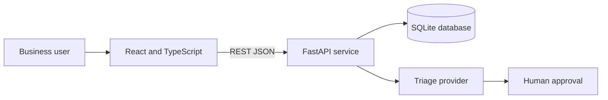

# OpsFlow Operations Request and Triage Pipeline

OpsFlow is a full-stack portfolio app that converts operational requests into accountable and reviewable work. It demonstrates how ambiguous business needs can be translated into a documented application with human-reviewed AI triage.

## What it demonstrates

- React and TypeScript user interface
- Python and FastAPI REST API
- SQLite persistence with an audit trail
- AI-assisted request classification with mandatory human approval
- Search, filtering, ownership, priority, and workflow status
- Backend integration tests
- GitHub Actions CI for backend tests and frontend builds
- Responsive interface designed for a real internal operations team

## Architecture

The application defaults to a deterministic local triage engine, so it runs without external credentials. If `OPENAI_API_KEY` is set, the backend requests a structured model recommendation. If that call fails, it automatically falls back to the local engine. In both cases, the recommendation remains unapproved until a person confirms or changes it.

## Quick start on Mac

Prerequisites: Python 3.12, Node.js 22 or newer, and npm.

1. Run `setup-mac.sh` once.
2. Run `start-mac.sh`.
3. Open <http://localhost:5173>.
